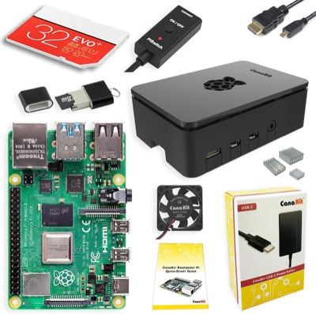
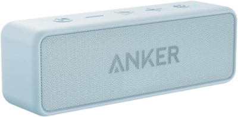

# pidog-groove

<p align="center">🇺🇸 <b>English</b> · 🇫🇷 <a href="README.fr.md">Français</a></p>

**PiDog listens to the music around it and moves its head and tail to the beat.**

No file to play, no score: it uses **its own microphone**,
detects the tempo of what it hears, and lands on the beats. Say
"PiDog, écoute la musique" ("PiDog, listen to the music") and it starts nodding along to whatever's playing.

Fourth project of the family, after [pidog-voice](https://github.com/koua29/pidog-voice),
[pidog-energy](https://github.com/koua29/pidog-energy) and
[pidog-patrol](https://github.com/koua29/pidog-patrol).

---

## The real problem: the dog hears itself

Detecting a tempo is a classic exercise. What makes this project hard
is specific to the robot, and it's **measured, not assumed**: moving servos
push the noise to **1513 RMS versus 35 in silence** — 42 times louder than the
captured music. A dog that moves its head to listen therefore mostly hears
itself, and a naive detector locks onto the rhythm of its own servos
(~85 BPM) instead of the song's.

The workaround rests on one thing we know exactly: **the moment we
command each gesture**. So those windows are masked from the microphone. The robot
only analyses what it hears *between* its movements.

```
   ┌─ listens still for 8 s ─┐
   │  estimates tempo + phase│   confident enough?
   └────────────┬────────────┘
                │ yes
                ▼
   ┌─ predicts the next beats ───┐   ← no need to hear EVERY beat anymore
   │  moves on them (head, tail) │
   │  masks the mic meanwhile    │   ← this is what makes the noise bearable
   │  re-estimates in the gaps   │
   └─────────────────────────────┘
```

Once the tempo is locked, it is **predicted** between two re-estimations: the
robot no longer needs to hear every beat, only to re-sync from time to
time. That's what makes the servo noise bearable.

## What it does, what it doesn't

- **Head and tail only.** Not the legs: nothing to knock over, little
  current drawn.
- **No sound emitted.** It listens, it doesn't play anything. The speaker stays free
  for the music you put on.
- **Any source.** A speaker, the TV, you singing — as long as
  there's a clear pulse.

## Tempo detection, verified

Everything runs on the Pi, **without librosa**: an onset envelope based on spectral
flux (a 1024-point FFT takes 86 µs on this Pi 4) and an
autocorrelation. Two fixes, each drawn from a measured failure:

- **Harmonic sum.** On a real recording at 120 BPM, the highest raw peak
  landed at 60 — half-tempo, the classic autocorrelation trap.
  A true period stands out because its multiples also
  correlate; a subdivision doesn't.
- **Fractional periods.** At 160 BPM the period is 37.5 frames of 10 ms:
  with integers, the rounding error piles up across the harmonics and the score
  collapses. So floating-point periods are evaluated.

The method is calibrated against **ground truth**: music recorded
with the robot's microphone, analysed by librosa on a separate machine. Results over
six sliding windows of a 120.0 BPM song:

| window | tempo found | confidence |
|---|---|---|
| 0–8 s | 120.6 | 1.51 |
| 4–12 s | 121.2 | 1.17 |
| 8–16 s | 121.8 | 1.16 |
| 12–20 s | 121.2 | 1.00 |
| 16–24 s | 120.0 | 0.93 |
| 20–28 s | 120.3 | 1.15 |

For reference, white noise gives a confidence of 0.13, speech 0.09:
the trigger threshold is 0.45, far from both.

## Installation

On the Pi:

```bash
rsync -az --exclude __pycache__ ./ pidog:~/script/pidog-groove/
ssh pidog 'python3 ~/script/pidog-groove/outils/verifier.py'
```

`verifier.py` checks the configuration and records 2 s from the microphone without touching the
servos.

## Usage

```bash
python3 ecoute.py                 # until duree_max_s, Ctrl-C to quit
python3 ecoute.py --duree 60
python3 ecoute.py --sans-robot    # listens and prints the tempo, without moving
python3 tests/test_rythme.py      # 11 tests, no hardware required
```

By voice, after `install/integrer_pidog_voice.sh`: **"PiDog, écoute la
musique."** Voice listening pauses meanwhile — otherwise it would share
the microphone and the GPIO — and resumes on its own at the end.

## Tuning the result

Everything is in `config.json`, no code to touch.

**The gesture vocabulary** is a list of weighted, randomly drawn moves.
Each `tete` (head) is `[yaw, roll, pitch]` as fractions of the amplitudes. Two
safeguards: never the same move twice in a row, and never two neighbouring
positions (otherwise the draw produces an imperceptible gesture that reads as a
miss).

**`temps_par_geste`** — one gesture every N quarter notes. At 2 it dances more, at 3 it
hears better: the more it moves, the more it drowns itself out. It's the first setting to
raise if it loses the beat.

**`fraction_attaque`** doesn't only set the look, but what it *hears*:
it's the share of the beat spent moving, the rest being held still —
and therefore available for listening.

## Pitfalls already found

Each one cost a session.

**A PATH without `/usr/sbin`.** `robot_hat` calls `i2cdetect` to scan the
I2C bus. Launched from a plain SSH session, that path is missing, the command is
not found, the scan returns an **empty** list, and the library then writes
into the void **without raising any error** — threads
alive, perfect gesture counters, not a single servo moving. So the program
fixes its own PATH at startup.

**`Pidog()` can start without its threads.** It returns with a
single thread and zero controllable motors, without an error. The program **checks that
`head_thread` and `tail_thread` are running** before commanding anything,
and refuses to continue otherwise.

**Never `kill -9` the robot.** A forced stop leaves GPIO lines
open → `GPIO busy` on the next launch and unstable initialisation. Stop it
with SIGTERM then SIGINT.

**It used to lose the beat mid-song.** Standing still it measured a confidence
of 1.45; while dancing, 0.65. A missed measurement while it moves doesn't
mean the music stopped: a song's tempo doesn't change, so the
patience before giving up is **deliberately generous** (40 s), and the tempo is
predicted between two re-syncs.

## 🤝 Project hardware

*Amazon affiliate links: if you buy through these links, the project earns a small commission at no extra cost to you.*

<table>
<tr>
<td align="center" width="33%">
  <a href="https://www.amazon.com/dp/B07V5JTMV9?linkCode=ll2&amp;tag=koua29pgroove-20&amp;ref_=as_li_ss_tl"></a><br>
  <b><a href="https://www.amazon.com/dp/B07V5JTMV9?linkCode=ll2&amp;tag=koua29pgroove-20&amp;ref_=as_li_ss_tl">CanaKit Raspberry Pi 4 (4 GB)</a></b><br><sub>Kit with the board that runs inside the dog</sub>
</td>
<td align="center" width="33%">
  <a href="https://www.amazon.com/dp/B0B7NVMBPL?linkCode=ll2&amp;tag=koua29pgroove-20&amp;ref_=as_li_ss_tl"></a><br>
  <b><a href="https://www.amazon.com/dp/B0B7NVMBPL?linkCode=ll2&amp;tag=koua29pgroove-20&amp;ref_=as_li_ss_tl">SanDisk 64 GB microSD (2-pack)</a></b><br><sub>Raspberry Pi OS and the project files</sub>
</td>
<td align="center" width="33%">
  <a href="https://www.amazon.com/dp/B0FLD69KFF?linkCode=ll2&amp;tag=koua29pgroove-20&amp;ref_=as_li_ss_tl"></a><br>
  <b><a href="https://www.amazon.com/dp/B0FLD69KFF?linkCode=ll2&amp;tag=koua29pgroove-20&amp;ref_=as_li_ss_tl">Anker Soundcore 2 (Bluetooth speaker)</a></b><br><sub>The music the dog listens to, and its replies</sub>
</td>
</tr>
</table>

<sub>As an Amazon Associate I earn from qualifying purchases.</sub>

## ☕ Buy me a coffee

This project is free and open source. If you find it useful, you can say thanks
by buying me a coffee — just scan this PayPal QR code. Thanks a lot! 🙏

<p align="center">
  
</p>

## The PiDog family

- **[pidog-voice](https://github.com/koua29/pidog-voice)** — French voice control
- **[pidog-energy](https://github.com/koua29/pidog-energy)** — battery monitoring
- **[pidog-patrol](https://github.com/koua29/pidog-patrol)** — autonomous patrol
- **pidog-groove** — you are here

## License

[MIT](LICENSE) © 2026 koua29
